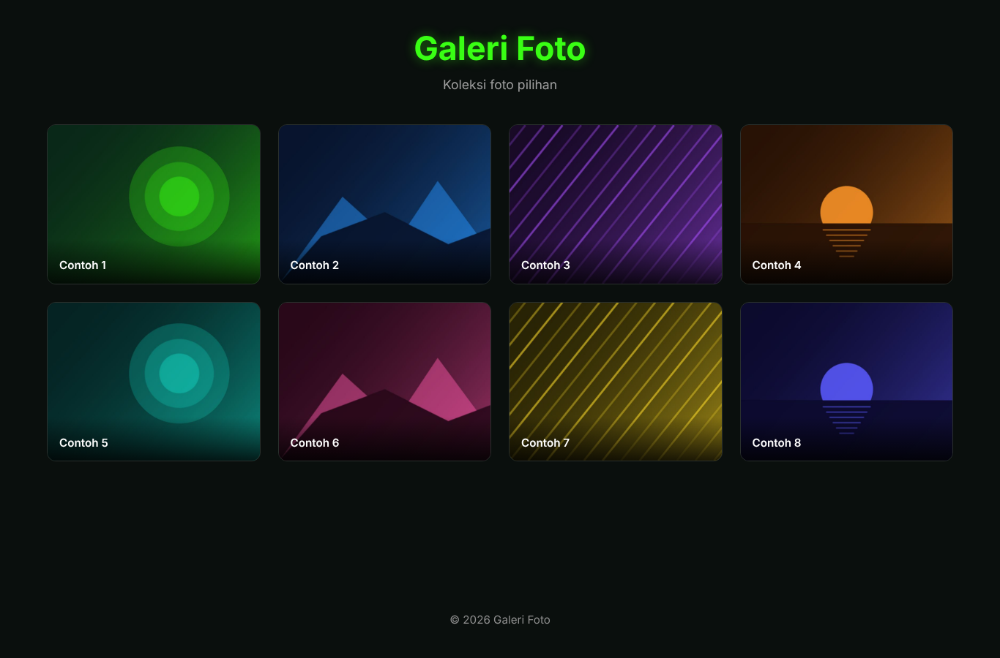

# Galeri Foto Grid

Galeri foto grid yang responsif, ringan, dan aman — dibangun dengan HTML, CSS, dan JavaScript murni tanpa library atau framework.

*A responsive, lightweight, and secure photo grid gallery built with plain HTML, CSS, and JavaScript — no libraries or frameworks. [English version below ↓](#english)*



---

## 🇮🇩 Bahasa Indonesia

### Fitur

- **Grid responsif** — kolom menyesuaikan otomatis dari HP hingga monitor lebar; semua kartu berukuran seragam (rasio 4:3).
- **Lightbox** — klik foto untuk memperbesar; navigasi dengan tombol, panah keyboard ← →, atau geser (swipe) di HP; tutup dengan `Esc` atau klik area gelap.
- **Mudah dipakai** — seluruh isi galeri (judul, subjudul, footer, daftar foto) diatur di **satu file**: `assets/js/gallery-data.js`.
- **Aksesibel** — bisa dioperasikan penuh dengan keyboard, fokus terlihat jelas, teks alternatif untuk pembaca layar, kontras warna lolos WCAG AA, dan menghormati pengaturan *reduce motion*.
- **Cepat** — thumbnail terpisah untuk grid, *lazy loading*, tanpa font/skrip dari server luar.
- **Aman** — lihat bagian [Keamanan](#keamanan).

### Struktur Proyek

```
galeri_foto_grid/
├── index.html
├── assets/
│   ├── css/style.css          # tampilan & warna (ubah di :root)
│   ├── js/gallery-data.js     # ← EDIT FILE INI untuk isi galeri
│   ├── js/gallery.js          # logika grid & lightbox
│   └── images/
│       ├── *.jpg              # foto ukuran penuh (untuk lightbox)
│       ├── thumbs/*.jpg       # thumbnail (untuk grid)
│       └── favicon.svg
├── tools/strip_exif.py        # hapus metadata & buat thumbnail
├── LICENSE
└── README.md
```

### Cara Menjalankan

Tidak perlu instalasi. Pilih salah satu:

1. **Langsung:** klik dua kali `index.html` untuk membukanya di browser.
2. **Server lokal (disarankan):**
   ```bash
   cd galeri_foto_grid
   python -m http.server 8000
   ```
   Lalu buka <http://localhost:8000>.

### Cara Menambahkan Foto Sendiri

1. Simpan foto asli di folder terpisah, misalnya `originals/` (folder ini sudah diabaikan oleh `.gitignore`).
2. Bersihkan metadata sekaligus buat thumbnail:
   ```bash
   pip install Pillow
   python tools/strip_exif.py originals --out assets/images
   ```
3. Daftarkan foto di `assets/js/gallery-data.js`:
   ```js
   photos: [
       {
           src: "assets/images/pantai.jpg",          // wajib — foto penuh
           thumb: "assets/images/thumbs/pantai.jpg", // opsional — thumbnail grid
           alt: "Matahari terbenam di pantai",       // wajib — deskripsi gambar
           caption: "Pantai, 2026"                   // opsional — keterangan
       }
   ]
   ```
4. Ubah juga `title`, `subtitle`, dan `footer` di bagian `site`. Tulisan `{year}` otomatis diganti dengan tahun berjalan.
5. Hapus gambar contoh `sample-*.jpg` jika sudah tidak dipakai.

### Kustomisasi Tampilan

Semua warna diatur sebagai variabel di bagian atas `assets/css/style.css`:

```css
:root {
    --bg-color: #0A0F0D;
    --primary-color: #39FF14;   /* warna aksen */
    ...
}
```

### Keamanan

| Perlindungan | Penjelasan |
|---|---|
| Content-Security-Policy | Hanya skrip, gaya, dan gambar dari situs sendiri yang boleh dimuat. Tanpa skrip/gaya inline. |
| Tanpa `innerHTML` | Semua teks dari konfigurasi dimasukkan sebagai teks biasa, jadi HTML/skrip tidak bisa disisipkan (anti-XSS). |
| Validasi path gambar | Hanya path lokal yang diterima; `http(s)://`, `//`, `javascript:`, dan `data:` ditolak. |
| Tanpa layanan pihak ketiga | Tidak ada Google Fonts, CDN, atau pelacak; alamat IP pengunjung tidak dikirim ke pihak lain. |
| `Referrer-Policy: no-referrer` | Alamat halaman tidak bocor saat pengunjung membuka tautan keluar. |
| Hapus EXIF/GPS | `tools/strip_exif.py` menghapus lokasi GPS dan info kamera dari foto. |

> ⚠️ **Penting:** foto dari HP sering menyimpan **koordinat GPS** tempat foto diambil. Selalu jalankan `strip_exif.py` sebelum meng-commit foto pribadi, dan jangan pernah meng-commit folder `originals/`.

Jika di-hosting di server yang mendukung header HTTP (misalnya Netlify atau Cloudflare Pages), tambahkan juga header berikut, yang tidak bisa diatur lewat `<meta>`:

```
Content-Security-Policy: frame-ancestors 'none'
X-Content-Type-Options: nosniff
```

### Deploy ke GitHub Pages

1. Push repositori ke GitHub.
2. Buka **Settings → Pages**, pilih branch `main` dan folder `/ (root)`.
3. Situs akan tersedia di `https://USERNAME.github.io/galeri_foto_grid/`.

### Kompatibilitas Browser

Chrome, Edge, Firefox, dan Safari versi terbaru. Di browser lama yang belum mendukung `<dialog>`, grid tetap tampil tanpa lightbox.

---

<a id="english"></a>

## 🇬🇧 English

### Features

- **Responsive grid** — columns adapt from phones to wide monitors; all cards share a uniform 4:3 ratio.
- **Lightbox** — click a photo to enlarge it; navigate with buttons, ← → arrow keys, or swipe on mobile; close with `Esc` or by clicking the dark area.
- **Easy to use** — all gallery content (title, subtitle, footer, photo list) lives in **one file**: `assets/js/gallery-data.js`.
- **Accessible** — fully keyboard-operable, visible focus, alt text for screen readers, WCAG AA color contrast, and respects *reduced motion*.
- **Fast** — separate grid thumbnails, lazy loading, no external fonts or scripts.
- **Secure** — see [Security](#security).

### Getting Started

No installation needed. Open `index.html` directly, or run a local server:

```bash
cd galeri_foto_grid
python -m http.server 8000
# open http://localhost:8000
```

### Adding Your Own Photos

1. Put your original photos in a separate folder such as `originals/` (already git-ignored).
2. Strip metadata and generate thumbnails:
   ```bash
   pip install Pillow
   python tools/strip_exif.py originals --out assets/images
   ```
3. Register each photo in `assets/js/gallery-data.js`, using `src` (required), `thumb` (optional), `alt` (required), and `caption` (optional). See the Indonesian example above.
4. Edit `title`, `subtitle`, and `footer` under `site`. `{year}` is replaced with the current year.
5. Delete the `sample-*.jpg` placeholders once you no longer need them.

<a id="security"></a>

### Security

- **Content-Security-Policy** restricts scripts, styles, and images to the site's own origin; no inline code.
- **No `innerHTML`**: config text is inserted as plain text, which prevents XSS.
- **Image path validation**: only same-origin local paths are accepted; `http(s)://`, `//`, `javascript:`, and `data:` are rejected.
- **No third parties**: no Google Fonts, CDNs, or trackers.
- **`no-referrer`** policy.
- **EXIF/GPS stripping** via `tools/strip_exif.py`.

> ⚠️ Phone photos often contain **GPS coordinates**. Always run `strip_exif.py` before committing personal photos, and never commit `originals/`.

### Deploy to GitHub Pages

**Settings → Pages →** branch `main`, folder `/ (root)`. The site is then served at `https://USERNAME.github.io/galeri_foto_grid/`.

---

## Lisensi / License

[MIT](LICENSE) © 2026 Rizky Maulana Hafis

Gambar contoh di `assets/images/sample-*.jpg` dibuat khusus untuk proyek ini dan tercakup dalam lisensi yang sama.
*The sample images were generated for this project and are covered by the same license.*
